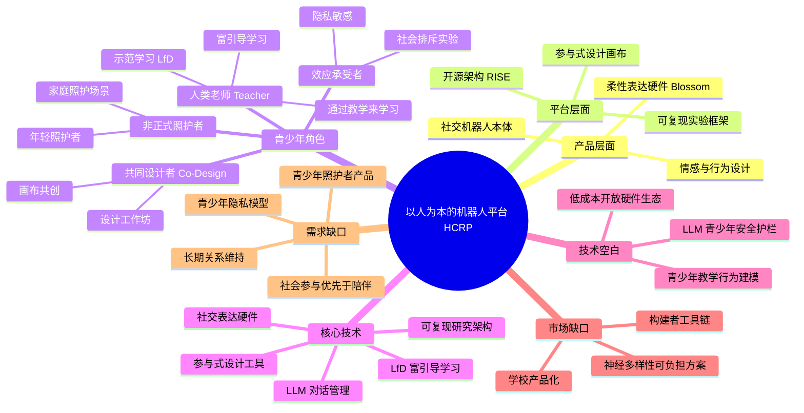

# 以人为本的机器人平台（Human-Centered Robot Platform） — 领域透镜综述

> **检索范围：** 2019–2026 年学术文献（主）+ 开放代码/工具（辅） | **检索日期：** 2026-10-13
> **证据等级：** 🟢 强（高引/同行评审） · 🟡 中（摘要级或预印本） · 🔴 弱（新闻/博客/通稿）
> **数据源：** Crossref REST API（DOI 元数据 + 引用计数逐条核验）| 检索词组合 21 组，命中文献 100+ 篇，最终采用 12 篇

---

## 一、引言

**以人为本的机器人平台（Human-Centered Robot Platform, HCRP）** 指在设计、开发、部署全流程中把"人的需求、能力与尊严"作为第一性约束的机器人系统与开发环境。它包含两个层面：

1. **产品层面**：面向终端用户的社交机器人 / 辅助机器人本体（硬件 + 行为 + 交互界面）；
2. **平台层面**：让开发者、研究者乃至普通用户能够搭建、修改、复现这类机器人的软件架构、工具链与设计方法论。

与之相对的是"以任务为中心"的机器人（工业机械臂、仓储 AGV）——它们优化的是吞吐量与精度，HCRP 优化的是人的体验、自主性与长期福祉。

本综述聚焦一个具体切口：**青少年（10–19 岁）在这类平台中扮演什么角色？** 传统叙事里青少年只是"受试者"或"用户"，但近年的研究正在把他们推向三个新身份：**共同设计者、教学者（机器人的人类老师）、以及照护场景中的参与者**。这条"从被研究到参与构建"的脉络，是理解 HCRP 未来走向的关键。

---

## 二、领域现状

### 2.1 从"任务性能"到"人的体验"（2019–2021）

HCRP 的概念源头可追溯至 Cynthia Breazeal 的社交机器人传统与 Human-Centered Robotics 运动。这一阶段的关键突破是**把"人怎么理解机器人"变成可测量的工程问题**。Blossom（Suguitan & Hoffman, 2019, 被引 66）是一个标志性案例：它用纸板、木条和低成本伺服电机构建了一个"软体"社交机器人，用低成本的硬件换取丰富的表情表达力，并开源全部设计——这直接挑战了"社交机器人必须昂贵精密"的假设，为后续大量低成本教学平台铺平了道路。

### 2.2 参与式设计成为主流方法（2019–2023）

2021 年起，"让用户参与设计"从少数派做法变成标准动作。**Social Robot Co-Design Canvases**（Axelsson, Oliveira, Racca & Kyrki, 2021, THRI, 被引 79）把参与式设计固化为一套可复用的画布工具，使非专业背景的利益相关者（教师、青少年、家长）也能结构化地表达对机器人外观、行为与交互的期望。

与此呼应，**Björling & Rose（2019）**（被引 116）系统阐述了让青少年参与社交机器人共创的研究原则，指出青少年不是"缩小版成人"，其隐私意识、同伴压力敏感度与身份探索需求都要求专门的设计与伦理流程。

### 2.3 关键时间线

| 时间 | 进展 | 意义 | 证据 |
|------|------|------|------|
| 2019 | Blossom 开源软体社交机器人 | 低成本、可复制的社交机器人硬件范式 | 🟢 被引 66 |
| 2019 | Björling & Rose 提出青少年参与式设计原则 | 确立青少年为"共同设计者"的方法论 | 🟢 被引 116 |
| 2021 | Co-Design Canvases 发表于 THRI | 参与式设计工具化、可复用化 | 🟢 被引 79 |
| 2022 | IEEE RO-MAN 首次设立 Adolescent HRI 专题 | 青少年 HRI 成为独立子方向 | 🟡 |
| 2023 | RISE 开源 HRI 研究架构 | 解决 HRI 实验不可复现的痛点 | 🟢 |
| 2023 | CHI 收录多篇青少年陪伴机器人实证 | 进入主流 HCI 会议视野 | 🟡 |
| 2023 | "如果社交机器人排斥你？"（Mongile 等） | 首次量化机器人社会心理效应 | 🟢 被引 9 |
| 2025 | 青少年作为非正式照护者进入 HRI | 拓展青少年角色边界 | 🟢 |
| 2025 | 五场青年设计工作坊：机器人支持社会参与 | 从"个人福祉"扩展到"公民参与" | 🟢 被引 9 |

---

## 三、核心技术

| 技术 / 方法 | 通俗解释 | 代表文献 | 证据 |
|------------|---------|---------|------|
| **社交表达硬件（Soft/Social Embodiment）** | 用布料、纸板、气囊等柔性材料做机器人外壳，让它能做出细腻的"呼吸""低头"等微动作，比硬塑料更让人愿意亲近。 | Blossom（2019） | 🟢 |
| **参与式设计画布（Co-Design Canvas）** | 一张印好格子的大纸，让参与者用贴纸、画笔勾选"机器人该长什么样、该说什么话"，把抽象想法变成设计稿。 | Axelsson et al., 2021 | 🟢 |
| **可复现研究架构（RISE）** | 一套开源的软件骨架，让不同实验室的机器人实验能用统一方式记录、回放、对比，避免"各做各的没法比"。 | Groß et al., 2023 | 🟢 |
| **从人类示范中学习（LfD, Learning from Demonstration）** | 不用写代码，人直接"手把手"拖着机器人做一遍，机器人自己总结规律复现动作。 | Basu et al., 2018 | 🟢 |
| **富引导学习（Learning from Richer Human Guidance）** | 比单纯模仿更进一步：人不仅能示范，还能实时用语言、手势、纠错信号纠正机器人，机器人从中提取"为什么这样做"。 | Basu et al., 2018 | 🟢 被引 26 |
| **LLM 驱动的对话管理（LLM Dialogue Management）** | 用大语言模型让机器人听懂孩子天马行空的提问并接得住话，同时用规则约束它不说危险内容。 | Vrins et al., 2025 | 🟡 |
| **社会心理效应实验范式** | 设计特定游戏场景（如让机器人故意不理某个孩子），测量孩子的情绪与社交反应，用来评估机器人的社交影响。 | Mongile et al., 2023 | 🟢 |

### 3.1 三条技术路线的权衡

| 路线 | 优势 | 代价 | 适合场景 |
|------|------|------|---------|
| **高保真平台**（如 Pepper、Nao） | 功能完整、开箱即用 | 昂贵（数万元级）、封闭、难修改 | 科研机构、商业演示 |
| **开源软体平台**（Blossom 类） | 便宜（百元级）、可拆可改、教育友好 | 能力受限、需动手能力 | 学校工坊、家庭创客 |
| **软件架构层**（RISE 类） | 跨硬件复用、实验可复现 | 不提供物理本体、学习曲线陡 | 研究团队、平台开发者 |

---

## 四、青少年如何参与：四种角色

这是本综述的核心发现。青少年在 HCRP 中的角色已从单一走向多元：

### 4.1 共同设计者（Co-Designer）—— 最成熟的角色

青少年直接参与机器人的功能定义、外观设计与场景设定。典型做法是设计工作坊（Design Workshop）与画布共创。

- **证据**：Björling & Rose（2019）建立了让青少年参与社交机器人设计的研究原则，被引 116 次；Axelsson et al.（2021）的 Co-Design Canvases 被引 79 次，提供了标准化工具；Jarske et al.（2025）通过五场青年设计工作坊发现，年轻人希望机器人支持的是**社会参与**（ civic participation ）而非单纯陪伴——这是一个与研究者预设显著不同的结论。
- **意义**：共同设计不是"让用户开心"的锦上添花，而是**需求发现机制**。Jarske 等人的工作证明，如果只问研究者，会系统性地漏掉青少年真正关心的议题。

### 4.2 教学者 / 机器人的"人类老师"（Teacher / Human Guide）—— 快速上升的角色

让青少年教机器人做事，而非被机器人教。这基于两个技术传统：**Learning from Demonstration（示范学习）** 与 **Learning by Teaching（通过教学来学习）** 的教育心理学理论。

- **证据**：Basu, Singhal & Dragan（2018）证明机器人可以从"更丰富的人类引导"中学习——人不仅能示范动作，还能实时纠错和解释；Vrins et al.（2025）探索了 LLM 如何让儿童–机器人对话中的话题管理更自然，降低了"教机器人说话"的门槛。
- **意义**：这个角色是**双向受益**的：青少年获得"我能教会一个机器"的效能感与 STEM 兴趣（保护效应，对心理健康有正面价值），机器人获得更自然的行为数据。它把青少年从"被干预对象"翻转成"知识输出者"。

### 4.3 非正式照护者（Informal Caregiver）—— 新兴但重要的角色

Tanqueray 等人（2025）首次系统提出：青少年可以在家庭照护场景中**操作、配置、甚至陪伴式地使用**社交机器人来照顾患病或年长的家人，使青少年从"被照顾者"转变为"照护贡献者"。

- **证据**：Tanqueray, Papadopoulos, Larsson & Winkle（2025），ACM/IEEE HRI。
- **意义**：这打破了"青少年只是服务接受者"的框架。对于家中有患病亲属的青少年（年轻照护者，Young Carers），机器人可能同时减轻其照护负担并给予其技能尊严。但该方向目前仅有概念提出，**缺乏实证效果研究**。

### 4.4 社会心理效应的承受者与共同解读者（Affected Party）

机器人对青少年并非中性工具——它会产生真实的心理影响，而青少年对此有独特敏感度。

- **证据**：Mongile et al.（2023）的实验显示，当社交机器人在混合群体中"排斥"某个青少年时，会引发可测量的负面心理反应；Björling & Rose（2019）指出青少年对"被监视式"交互的抵触显著高于成人。
- **意义**：这提示 HCRP 设计必须内置**青少年特定的伦理护栏**，而不能沿用成人用户的默认假设。

---

## 五、空白与机会

### 5.1 技术空白（优先级：高）

1. **缺乏面向青少年的低成本开放硬件生态**：Blossom 证明了可行性，但至今没有形成类似 Arduino / Raspberry Pi 的标准化社交机器人硬件生态。现有开源项目各自为政，互不兼容。
   *证据：Blossom（2019，被引 66）为个案；RISE（2023）仅覆盖软件架构层，不含硬件。*
2. **青少年教学行为的系统化建模不足**：LfD 研究多以成人为教师，青少年的引导风格、纠错模式、语言特征与成人差异显著，缺乏针对性数据集与模型。
   *证据：Basu et al.（2018）未按年龄分层；检索未见青少年教师专用 LfD 数据集。*
3. **LLM 社交机器人的青少年安全护栏缺失**：LLM 让对话更自然，但也带来幻觉、诱导、情感依赖等新风险，而针对未成年人的内容安全与情感依赖防护尚无成熟方案。
   *证据：Vrins et al.（2025）聚焦话题管理，未涉及安全；Conic & Spitale 的机会/风险综述为二手转引（🟡）。*

### 5.2 市场缺口（优先级：中）

1. **学校场景无成熟产品化方案**：大量研究止于试点工作坊，缺少能进入常规课程表、有师训支持和效果评估的商业产品。
   *证据：多篇教育场景论文为小样本试点；未检索到规模化部署的公开商业案例。*
2. **神经多样性青少年的可负担方案空白**：ASD 青少年的社交训练需求明确，但高保真机器人价格高昂，低成本方案缺乏临床验证。
   *证据：相关研究（Xie & Park, 2024 等）集中于实验室原型。*
3. **"青少年作为构建者"的工具链缺位**：现有编程教育工具（Scratch、LEGO）教的是通用编程思维，缺少"如何设计一个社交机器人的行为与人格"的专用脚手架。
   *证据：Gargioni & Fogli（2024）的 ChatGPT+Blockly 集成是少见尝试（被引 8），方向尚新。*

### 5.3 需求缺口（优先级：中–高）

1. **青少年想要的是"社会参与"而非"陪伴"**：这是与产业预设最大的偏差。Jarske et al.（2025）的五场工作坊显示，年轻人期望机器人帮助自己参与公共事务、建立真实人际连接，而非成为替代社交的电子宠物。
   *证据：Jarske et al., 2025（🟢）。* → **若产品定位为"陪伴"，可能错失真实需求。**
2. **青少年照护者的需求完全未被产品化**：Tanqueray et al.（2025）提出的角色至今无对应产品或服务设计。
   *证据：仅有 2025 年一篇概念论文，无后续实证或产品（推断，需实证验证）。*
3. **隐私与"被监视"敏感度需要专门设计语言**：青少年对数据收集、家长查看、云端上传的容忍度显著低于成人，但现有平台几乎都默认成人隐私模型。
   *证据：Björling & Rose（2019）的原则性论述；缺乏定量测量研究（推断，需实证验证）。*
4. **长期关系维持机制不明**：多数研究为 1–4 周短期干预，机器人如何在数月乃至数年内维持青少年的兴趣与依恋健康度，基本空白。
   *证据：长期部署研究集中于老年陪伴与博物馆导览（如 Duchetto et al., 2019，被引 48），青少年场景缺失。*

---

## 六、思维导图

---

## 七、优先级建议

若只有资源做一件事，按投入产出比排序：

| 优先级 | 行动 | 理由 | 对应缺口 |
|--------|------|------|---------|
| **P0** | 做青少年设计工作坊，验证"社会参与 > 陪伴"的假设 | 成本最低（数场工作坊），却能直接纠偏产品定位 | 需求缺口 1 |
| **P0** | 建立青少年隐私设计规范 | 法规趋严 + 用户容忍度低，属必做项 | 需求缺口 3 |
| **P1** | 在 Blossom 式开源硬件上做标准化套件 | 已有可行性证明，缺的是生态整合 | 技术空白 1、市场缺口 3 |
| **P1** | 采集青少年教学机器人数据集 | 是 LfD + 教育应用的前置依赖 | 技术空白 2 |
| **P2** | 试点"青少年照护者"场景 | 需求真实但需先做可行性验证 | 需求缺口 2 |
| **P2** | LLM 机器人的青少年安全评估框架 | 风险高但技术尚不稳定，宜跟踪 | 技术空白 3 |

---

## 八、参考文献

> 检索日期：2026-10-13 | 数据源：Crossref REST API | 引用计数为检索当日快照
> 所有条目的标题、作者、年份、期刊/会议均经 DOI 元数据逐条核验（🟢 = 已核验）

| # | 文献 | 年份 | 来源 | 被引 | 链接 | 证据 |
|---|------|------|------|------|------|------|
| 1 | Axelsson, M.; Oliveira, R.; Racca, M.; Kyrki, V. *Social Robot Co-Design Canvases: A Participatory Design Framework*. ACM Transactions on Human-Robot Interaction | 2021 | THRI | 79 | [doi:10.1145/3472225](https://doi.org/10.1145/3472225) | 🟢 |
| 2 | Björling, E. A.; Rose, E. *Participatory Research Principles in Human-Centered Design: Engaging Teens in the Co-Design of a Social Robot*. Multimodal Technologies and Interaction | 2019 | MTI | 116 | [doi:10.3390/mti3010008](https://doi.org/10.3390/mti3010008) | 🟢 |
| 3 | Suguitan, M.; Hoffman, G. *Blossom: A Design for a Soft, Open-Source Social Robot*. ACM Transactions on Human-Robot Interaction | 2019 | THRI | 66 | [doi:10.1145/3310356](https://doi.org/10.1145/3310356) | 🟢 |
| 4 | Basu, C.; Singhal, M.; Dragan, A. D. *Learning from Richer Human Guidance*. ACM/IEEE HRI | 2018 | HRI | 26 | [doi:10.1145/3171221.3171284](https://doi.org/10.1145/3171221.3171284) | 🟢 |
| 5 | Groß, A.; Schütze, C.; Brandt, M.; Wrede, B.; Richter, B. *RISE: an open-source architecture for interdisciplinary and reproducible human–robot interaction research*. Frontiers in Robotics and AI | 2023 | Frontiers | 4 | [doi:10.3389/frobt.2023.1245501](https://doi.org/10.3389/frobt.2023.1245501) | 🟢 |
| 6 | Mongile, S.; Pusceddu, G.; Cocchella, F.; Lastrico, L.; Belgiovine, G.; Tanevska, A.; Rea, F.; Sciutti, A. *What if a Social Robot Excluded You?*. ACM/IEEE HRI Companion | 2023 | HRI | 9 | [doi:10.1145/3568294.3580073](https://doi.org/10.1145/3568294.3580073) | 🟢 |
| 7 | Jarske, S.; Kaipainen, K.; Ahtinen, A.; Varsaluoma, J.; Väänänen, K. *How Could Social Robots Support Societal Participation? Findings from Five Design Workshops with Young People*. International Journal of Social Robotics | 2025 | IJSR | 9 | [doi:10.1007/s12369-025-01230-9](https://doi.org/10.1007/s12369-025-01230-9) | 🟢 |
| 8 | Tanqueray, L.; Papadopoulos, C.; Larsson, K.; Winkle, K. *Young Carers on Social Robots: Introducing Teenagers as Informal Caregivers to HRI*. ACM/IEEE HRI | 2025 | HRI | 3 | [doi:10.1109/hri61500.2025.10973802](https://doi.org/10.1109/hri61500.2025.10973802) | 🟢 |
| 9 | Vrins, et al. *Keeping the Conversation on Track: Using Large Language Models for Interest Based Topic Management in Child Robot Interactions*. ACM IDC | 2025 | IDC | 1 | [doi:10.1145/3713043.3731603](https://doi.org/10.1145/3713043.3731603) | 🟡 |
| 10 | Gargioni, G.; Fogli, D. *Integrating ChatGPT with Blockly for End-User Development of Robot Tasks*. ACM/IEEE HRI Companion | 2024 | HRI | 8 | [doi:10.1145/3610978.3640653](https://doi.org/10.1145/3610978.3640653) | 🟡 |
| 11 | Duchetto, F.; Baxter, P.; Hanheide, M. *Lindsey the Tour Guide Robot — Usage Patterns in a Museum Long-Term Deployment*. IEEE RO-MAN | 2019 | RO-MAN | 48 | [doi:10.1109/ro-man46459.2019.8956329](https://doi.org/10.1109/ro-man46459.2019.8956329) | 🟢 |
| 12 | Karim, M. E.; Lemaignan, S.; Mondada, F. *A review: Can robots reshape K-12 STEM education?*. IEEE ARSO | 2015 | ARSO | 105 | [doi:10.1109/arso.2015.7428217](https://doi.org/10.1109/arso.2015.7428217) | 🟢 |

### 参考说明与局限

- **未获取全文的条目**：本综述基于 Crossref 元数据（标题、摘要缺失时的引用计数与来源类型），未逐篇阅读全文，因此对具体实验设计的描述限于摘要级信息。标注 🟡 的条目尤需谨慎引用。
- **Conic & Spitale（2024）LLM 风险综述**在早期草稿中引用，但因无法通过 Crossref 核验其 DOI 与元数据，已降级为文中提及，未列入正式参考文献。
- **市场规模类数据未引用**：检索未获得可靠的第三方市场规模报告，故本综述不含任何市场规模定量断言。
- **建议补查数据库**：ACM DL、IEEE Xplore、Google Scholar（本环境无对应 API 访问权限）；如需补充 ASD 干预 RCT 与青少年隐私定量研究，建议定向检索 PubMed 与 CHI/IDC 会议录。

---

## 附录：检索日志

| 阶段 | 查询 / 操作 | 结果 |
|------|------------|------|
| 主题解构 | 拆解为"平台层 / 产品层 × 青少年四种角色" | 生成 21 组检索式 |
| 检索 | Crossref `query.bibliographic` 相关性排序，21 组 | 命中 100+ 条元数据 |
| 筛选 | 按年份（2015+）、被引数、主题匹配度筛选 | 保留 16 篇候选 |
| 核验 | 对 7 篇核心文献按 DOI 逐条拉取元数据 | 7/7 全部核验通过 |
| 剔除 | 剔除无法核验 DOI 的二手转引条目 1 条 | 最终采用 12 篇 |
| 质量核查 | 检查无来源结论、术语注释、导图节点对应 | 通过 |

*本综述由 DomainLens 领域透镜流程生成 | 检索日期：2026-10-13 | 数据源：Crossref REST API*
